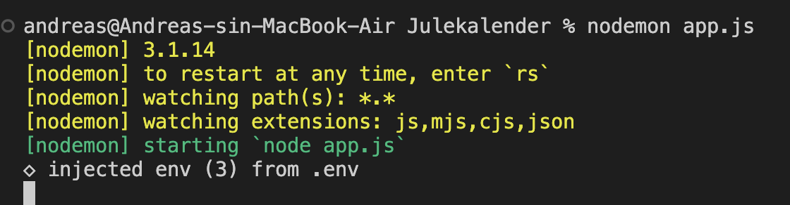

## Prosjektbeskrivelse: Hva er julekalenderen, og hva skal løsningen brukes til?
Julekalenderen er en webapplikasjon som elever på skolen kan bruke fra 1 desember til den 24 desember. Meningen med julekalenderen er å skape en morsom webapplikasjon som elvene på skolen kan bruke og ha en rettferdig sjanse på å vinne premier for hver luke. Jo flere som er med, jo mer spennede blir resultatene. 

## Funksjonalitet: Hvilke funksjoner har løsningen for brukere og administratorer?
Brukere (deltakere)
- __Registrering med skolemail:__ Brukere må skrive inn e-post adressen sin for å svare på sprøsmål. (Må være @afk mail)
- __Julekalender:__ Brukeren kan åpne en luke hver dag i desmeber fram til den 24 på forsiden av applikasjonen og svare på et sprøsmål
- __Tre typer Spørsmål:__
    - Video
    - Åpent spørsmål
    - Flervalg spørsmål
- __Innsending av svar:__ Svaret til brukeren lagres i mongodb databasen sammen med brukernavn og luke
- __Logg ut:__ Brukeren kan velge å være registrert eller logge ut etter å ha sent inn et svar. Registreringen varer i 30 dager før man blir logget ut

Administartorer (lærer)
- __Dashboard:__ Dashboard er bare tilgjengelig for brukere min admin (teacher) status. Andre roller som brukere har ikke tilgang til denne siden
- __Oversikt:__ Viser hvor mange deltakere som er registrert på applikasjonen, og hvilken dag det er. 
- __Se innsendte svar:__ En overskt over alle innsendte svar fra deltakerene 
- __Retting:__ Flervalg spørsmål blir automatisk verifsiert somm riktig eller galt, mens åpne og video sprøsmål må bli verifisert av lærer (admin)
- __Brukerliste:__ Viser en oversikt over alle brukere som er logget inn! Her ser man brukernavn, bruker status, mail og profil icon


## Teknologier
I dette julekalenderprosjektet har jeg brukt følgende teknologier:
- __Node.js__
- __Express__
- __EJS__
- __MongoDB__
- __CSS__
- __JavaScript__
- __Git og GitHub__
- __HTML__
- __GitHub Projects__ 
- __linux-server__
- __pm2__


## Kloning og installerer prosjektet, hvordan installeres nødvendige dependencies og hvordan man starter applikasjonen i utviklingsmiljøet

Før man kan klone og legge til "dependencies" som betyr avhengigheter, må man ha følgende installert på datamaskinen:
- __Git__
- __Node__

 Sjekk git ved å skrive:
```bash
git --version
```
Sjekk node og npm ved å skrive:
```bash
node --version
```
```bash
npm --version
```
OBS: Hvis man får opp feilmeldinger vil det si at git eller node ikke er installert
Nå som dette er gjort gjør man følgende:
1. Åpme terminalen på pcen
2. Skriv inn:
```bash
cd documents
```
3. Deretter kan man skrive git clone fordi den lager en mappe selv i den mappen man befinner deg i: 

```bash
git clone https://github.com/LohnyVal/Julekalender
```

4. Nå kan man gå inn på mappen og installere avhengigheter med følgende kommando:
```bash
cd julekalender
```
```bash
npm install
```
5. Når dette er gjort kan man gå inn på visual studio code(eller en selvvalgt programmerings program) og lage en fil som heter .env. .Env filen blir ikke med i github fordi den innholder hemmeligheter
6. Legg inn disse i .env filen:
- __MONGODB=mongodb-lenke__
- __SECRET_JWT: en-lang-hemmelig-tekst__
- __PORT:4000__

7. Legg alle sprørsmålene i databasen ved å skrive følgene  kommandoe i terminal:
```bash
node seed.js
```

8. Start applikasjonen ved å skrive:
```bash
nodemon app.js
```

Da vil man få en bekreftelse fra serveren som ser slik ut:



## Konfigurasjon: Hvilke miljøvariabler og innstillinger må være på plass?
- ???


## Database: Hvordan er databasen organisert, og hvilke data lagres?
Julekalender prosjketet bruker MongoDB som databasesystem. Denne databsen er organsiert med flere collections (modeller). 
De modellene jeg bruker i prosjketet mitt er følgende:
- Users: Lagrer informasjon om brukeren som email og et brukernavn basert på mailen
- Quizzes: Er sprøsmål satt inn i MongoDB via seeding fra seed.js som kjører et script for å legge in spørsmål til databasen
- Answers: Lagrer alle deltakeres svar, brukernavn, spørsmål og hvilke dag det var

I prosjketet bruker jeg mongoose schema for å lage modellene


## Utrulling: Hvordan settes løsningen opp på Linux-serveren?


## Brukerveiledning: Hvordan bruker man julekalenderen og eventuelle administrasjonsfunksjoner?
Steg for steg for bruk av julekalenderen som en deltaker:
1. Det første man ser er julekalenderen. Når man trykker på en luke for første gang vil man bli sendt til en register bruker side hvor man som bruker må skive inn din personlige skole mail som har @afk i seg. 
2. Nå vil man ble sendt tilbake til kalenderen og kan nå trykke på en dagns luke. Man vil ikke kunne åpne en tidligere eller senere luke enn den dagen man er på. 
3. Når man har ankommet spørsmål siden kan man nå svare på et spørsmål. Det er 3 forskjellige type spørsmål typer som man kan få. Det er enten flervalg spørsmål, video eller et åpent sprøsmål. På flervalg velger man en avd alternativene, mens på video og det åpne sprøsmålet må du skrive inn svaret selv. 
4. Nå så man har sent inn et svar vil man dagen etter vite hvem som har vunnet den dagen (luken) og dette ser man ved å gå tilbake på luken hvor navnet til den personen som vant vil bli vist. 

Steg for steg for bruk av julekalender som en administartor (lærer):
OBS: Admin kan også sende inn svar
1. Når en persom logger seg inn som admin, altså lærere med admin rolle, vil de også bli sendt til julekalender siden etter registering
2. Deretter gåt man inn til dashboard og vil ble da sendt til dashboard siden hvor man kan adminsitrere svar, vinnere og ser alle brukerene på webapplikasjonen.
3. Nå som man har kommet til siden vil man som admin først gå igjennom svarene til deltakerene (elevene) for å verifisere deres svar. 
4. Deretter når alle svar har blitt svart på, skal admin trykke på en knapp som vil generere en tilfeldig vinner. Da vil navnet til den personen vises på den luken den eleven vant i. 


## Videre utvikling: Hvilke funksjoner eller forbedringer kunne vært aktuelle å implementere senere?
Det er en del funksjoner jeg ville ha lagt til som jeg ikke rakk i denne oppgen. Noen eksempler er å lage et filter svar funkjson som filterer alle svar som er riktige, feil eller venter verifisering av admin (lærer). Jeg ville også ha lagt på litt mer animasjoner for hvilke luker som var ferdig, hvilken luke man var på og fremtidlige luker. Jeg kunne ha forbedret utseende av applikasjonen for å gjøre admin siden litt mer morsom og fin. 


